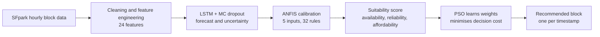

# Hybrid LSTM-ANFIS-PSO Framework for Hourly Parking Availability Forecasting and Price-Aware Block Recommendation


A three-stage pipeline that forecasts next-hour parking availability for on-street blocks, calibrates the forecast with a neuro-fuzzy system, and recommends one block per decision time by trading off availability, forecast reliability and price. It is built and evaluated on hourly block-level data from **SFpark** (San Francisco).

> **Honest summary of the findings.** ANFIS calibration clearly reduces forecast error. The PSO-weighted recommendation mainly trades a little availability for cheaper blocks; its extra gain over ANFIS-only selection is very small (0.15% in composite cost), and the learned reliability weight is about zero. See [Results](#results) and [Limitations](#limitations).

---

## Table of contents

1. [Overview](#overview)
2. [Pipeline](#pipeline)
3. [Key contributions](#key-contributions)
4. [Data](#data)
5. [Method](#method)
6. [Evaluation protocol](#evaluation-protocol)
7. [Results](#results)
8. [Limitations](#limitations)
9. [Repository structure](#repository-structure)
10. [Installation](#installation)
11. [Usage](#usage)
12. [Input files and required columns](#input-files-and-required-columns)
13. [Outputs](#outputs)
14. [Configuration](#configuration)
15. [Reproducibility](#reproducibility)
16. [Future work](#future-work)
17. [Citation](#citation)
18. [Authors](#authors)
19. [References](#references)
20. [License](#license)

---

## Overview

Drivers searching for parking add to congestion, fuel use and emissions. A guidance system that only shows *current* availability cannot say whether a block will still have space on arrival, and most forecasting studies stop at error metrics (MAE, RMSE) without checking whether the block they would recommend was actually a good choice.

This project couples forecasting and recommendation and evaluates both against what actually happened at the target hour:

| Stage | Model | Role |
|---|---|---|
| 1 | **LSTM** with Monte Carlo dropout | Forecast next-hour General Metered Parking (GMP) availability and an uncertainty estimate |
| 2 | **ANFIS** (first-order Takagi-Sugeno) | Calibrate the LSTM forecast using its uncertainty, current state, trend and price |
| 3 | **PSO** | Learn the weights of a suitability score over calibrated availability, reliability and affordability, then rank candidate blocks |

---

## Pipeline



Chronological split (by unique target timestamp, so all candidate blocks of one timestamp stay in the same partition):

| Partition | Share | Used for |
|---|---|---|
| Train | 60% | Fit ANFIS (and scalers) |
| ANFIS validation | 10% | Early stopping |
| PSO validation | 15% | Tune PSO weights |
| Test | final 15% | One-time final evaluation |

---

## Key contributions

- **Pipeline** connecting LSTM forecasting, ANFIS calibration and a PSO-weighted recommendation score for block-level parking guidance.
- **ANFIS used as a calibration stage** applied to LSTM forecasts, rather than as a parallel predictor fused by learned weights.
- **Two-level evaluation** on the same held-out blocks and timestamps: forecasting metrics (MAE, RMSE, R², bias) and decision metrics (realised availability, rate, composite cost, regret against a hindsight oracle).
- **Transparent reporting of what did not work:** PSO assigns almost zero weight to the reliability (uncertainty) term, so the data do not show that the uncertainty term improves recommendations.

---

## Data

- **Source:** SFpark hourly on-street parking occupancy and rate data from the San Francisco Municipal Transportation Agency (SFMTA). Interpretation of the fields follows the SFMTA data guide.
- **Unit of observation:** one parking block at one hourly timestamp (`BLOCK_ID`, `START_TIME_DT`).
- **Target:** next-hour GMP availability, `y = A_GMP(b, t+1)`, a value in [0, 1].
- **Not included in this repository.** Obtain the SFpark data from SFMTA and place the prepared files as described in [Input files](#input-files-and-required-columns).

### Cleaning rules

- Records before the documented data start (1 April 2011) are dropped.
- The known unrecoverable outage (10-17 December 2012) is excluded.
- West Portal is excluded because of persistent sensor-performance problems.
- Observations are kept only when the GMP unknown-time rate is at most 0.50.
- Missing GMP occupancy is **not** imputed as zero. Unknown time is excluded from the occupancy denominator.
- Duplicate block-hours are checked; lags, rolling statistics and targets never cross a gap or invalid observation. Consecutive observations must be exactly one hour apart.

### Features (24)

| Category | Variables |
|---|---|
| Parking state | `GMP_OCCUPANCY`, `GMP_AVAILABILITY`, `OP_OCCUPANCY`, `OP_AVAILABILITY`, `TOTAL_OCCUPANCY` |
| Data quality and monitoring | `TOTAL_UNKNOWN_RATE`, `OP_UNKNOWN_RATE`, `GMP_UNKNOWN_RATE`, `EFFECTIVE_MONITORED_SPACES` |
| Operational context | `NONOP_RATE`, `GMP_COMM_SHARE` |
| Parking price | `RATE`, `RATE_CHANGE` |
| Calendar context | `HOUR_SIN`, `HOUR_COS`, `DOW_SIN`, `DOW_COS`, `WEEKEND` |
| Occupancy dynamics | `GMP_OCC_LAG_1`, `GMP_OCC_LAG_2`, `GMP_OCC_LAG_3`, `GMP_OCC_CHANGE_1`, `GMP_OCC_CHANGE_3`, `GMP_ROLLING_MEAN_3` |

Hour and day of week use cyclic encodings, e.g. $H_{\sin}=\sin(2\pi h/24)$, $H_{\cos}=\cos(2\pi h/24)$, so that hour 23 and hour 0 are close. The primary configuration uses a **3-hour lookback** and a **1-hour prediction horizon** (input shape `N x 3 x 24`).

---

## Method

### Stage 1: LSTM forecast with uncertainty

A single-layer LSTM (two layers overfitted) maps the 3-hour history to next-hour availability, trained with an MAE loss. Features are min-max scaled with training-set statistics only.

Monte Carlo dropout (rate 0.2, $M = 100$ stochastic forward passes) gives the forecast and an uncertainty:

$$\hat A_{b,t+1}=\frac1M\sum_{m=1}^{M}\hat A^{(m)}_{b,t+1},\qquad u_{b,t}=\sqrt{\frac1M\sum_{m=1}^{M}\big(\hat A^{(m)}_{b,t+1}-\hat A_{b,t+1}\big)^2}$$

The mean is `PREDICTED_GMP_AVAILABILITY` and the standard deviation is `PREDICTION_UNCERTAINTY` in the forecast file used by the next stages.

### Stage 2: ANFIS calibration

Inputs (normalised to [0, 1] with training statistics, out-of-range values clipped):

1. LSTM predicted availability
2. LSTM uncertainty
3. Latest observed GMP availability
4. Latest one-hour occupancy change
5. Parking rate

A first-order Takagi-Sugeno system with two Gaussian membership functions per input gives $2^5 = 32$ rules:

$$\mu_{ij}(z_i)=\exp\!\Big[-\frac{(z_i-c_{ij})^2}{2s_{ij}^2}\Big],\qquad w_k=\prod_{i=1}^{5}\mu_{ik}(z_i),\qquad \bar w_k=\frac{w_k}{\sum_{\ell}w_\ell}$$

$$q_k(\mathbf z)=p_{k0}+\sum_{i=1}^{5}p_{ki}z_i,\qquad z_{raw}=\sum_{k=1}^{32}\bar w_k\,q_k(\mathbf z),\qquad \hat A^{ANFIS}=\frac{1}{1+e^{-z_{raw}}}$$

The sigmoid keeps the calibrated availability in [0, 1]. The model has **212 trainable parameters** (20 membership-function parameters and 192 consequent coefficients) and is trained by minimising MSE with Adam (gradient-based training, not the classical hybrid least-squares procedure).

### Stage 3: PSO-weighted suitability and recommendation

Uncertainty and rate are min-max normalised with training statistics, then converted to "higher is better" scores:

$$R_{b,t}=1-\tilde u_{b,t}\quad(\text{reliability}),\qquad P_{b,t}=1-\tilde r_{b,t}\quad(\text{affordability})$$

$$S_{b,t}=w_A\,\hat A^{ANFIS}_{b,t+1}+w_R\,R_{b,t}+w_P\,P_{b,t},\qquad w_A,w_R,w_P\ge 0,\ \ w_A+w_R+w_P=1$$

$$b_t^*=\arg\max_{b\in C_t}S_{b,t}$$

PSO searches the weight simplex for the weights that minimise the **mean composite decision cost** on the PSO-validation period (see below). Particle update:

$$\mathbf v_i^{k+1}=\omega\,\mathbf v_i^k+c_1r_1(\mathbf p_i-\mathbf x_i^k)+c_2r_2(\mathbf g-\mathbf x_i^k),\qquad \mathbf x_i^{k+1}=\mathbf x_i^k+\mathbf v_i^{k+1}$$

After each update, components are floored at $10^{-9}$ and the vector is renormalised to sum to one.

### Composite decision cost

$$J_{b,t}=\big(1-A^{actual}_{b,t}\big)+\lambda\,\tilde r_{b,t},\qquad \lambda=0.15$$

- `1 - A_actual` is the availability shortfall (0 means a perfectly free block).
- `r~` is the normalised parking rate, so price and availability share a 0-1 scale.
- $\lambda$ is a price-availability exchange rate: moving from the cheapest to the most expensive block counts as much as a 15-point drop in availability. **It is an assumption, not an estimated value**; sensitivity analysis is recommended.
- It uses *actual* (hindsight) availability, so it is used only to tune PSO and to evaluate policies, never by a deployed system.

PSO fitness: $F(\mathbf w)=\frac{1}{|\mathcal T|}\sum_{t\in\mathcal T}J_{b_t^*(\mathbf w),t}$, over tuning timestamps with at least two candidate blocks.

---

## Evaluation protocol

Two separate evaluations on the held-out test period:

**1. Forecasting** (3,413 block-time observations across 130 target timestamps). Raw LSTM and ANFIS-calibrated predictions are scored on identical observations:

$$\text{MAE}=\frac1N\sum|\hat y_i-y_i|,\quad \text{RMSE}=\sqrt{\frac1N\sum(\hat y_i-y_i)^2},\quad R^2=1-\frac{\sum(\hat y_i-y_i)^2}{\sum(y_i-\bar y)^2},\quad \text{Bias}=\frac1N\sum(\hat y_i-y_i)$$

Negative bias means systematic under-prediction. Errors are reported in percentage points (value x 100).

**2. Recommendation** (123 timestamps with at least two eligible candidate blocks; the other 7 are excluded because there is nothing to choose between). Three policies choose from the same candidates:

| Policy | Selects the block with the highest... |
|---|---|
| LSTM | raw LSTM predicted availability |
| LSTM + ANFIS | ANFIS-calibrated availability |
| LSTM + ANFIS + PSO | PSO-weighted suitability score |

Each choice is scored with the availability and rate that were actually observed:

- **Mean realised availability** and **mean rate** of the selected blocks.
- **Mean composite cost** $J$ (lower is better).
- **Regret** against a hindsight oracle, computed per timestamp over the candidate *blocks*:

$$\text{Regret}_t=J_{b_t^{\pi},t}-\min_{j\in C_t}J_{j,t}$$

Because all policies share the same oracle (mean oracle cost about 0.2412), regret orders the policies exactly as cost does; it adds interpretation (distance from the best achievable choice), not independent evidence.

A **cluster bootstrap** (resampling target timestamps, 1,000 replicates) gives exploratory confidence intervals for the forecasting differences.

---

## Results

### Forecasting (test set, N = 3,413)

| Model | MAE (pp) | RMSE (pp) | R² | Bias (pp) |
|---|---|---|---|---|
| LSTM (raw) | 10.55 | 13.98 | 0.6736 | -3.82 |
| **LSTM + ANFIS** | **9.06** | **12.47** | **0.7401** | **-1.22** |

- MAE reduced by 14.12% and RMSE by 10.77%.
- Cluster-bootstrap 95% intervals: MAE reduction 1.49 pp (1.33-1.68), RMSE reduction 1.51 pp (1.26-1.77), R² increase 0.0665 (0.0568-0.0769). None includes zero. Treat as exploratory because nearby timestamps may be dependent.


### Recommendation (same 123 timestamps)

| Policy | Actual availability (%) | Mean rate | Cost | Regret |
|---|---|---|---|---|
| LSTM | 75.14 | 2.128 | 0.3010 | 0.0598 |
| LSTM + ANFIS | **76.67** | 2.274 | 0.2906 | 0.0493 |
| LSTM + ANFIS + PSO | 75.79 | **1.967** | **0.2901** | **0.0489** |

- Full pipeline lowers cost by **3.6%** vs raw LSTM selection (0.3010 to 0.2901) but by only **0.15%** vs ANFIS-only selection (0.2906).
- PSO selects blocks that are about 13.5% cheaper than ANFIS-only selection (rate 1.967 vs 2.274) at about 0.9 points lower availability (75.79% vs 76.67%).
- The PSO policy is a price-availability trade-off, not a large improvement in overall cost.


### Learned PSO weights

| Component | Weight |
|---|---|
| ANFIS-calibrated availability | 0.871632 |
| Reliability (inverse normalised uncertainty) | about 0 (9e-10) |
| Affordability (inverse normalised rate) | 0.128368 |


**Reading the weights.** With the reliability weight at about zero, ranking by the suitability score is equivalent to ranking by $\hat A - (w_P/w_A)\,\tilde r$. The learned ratio $w_P/w_A = 0.147$ is close to the cost coefficient $\lambda = 0.15$: PSO essentially recovers the price-availability exchange rate built into the cost. Because the cost is linear in actual availability, uncertainty has no role in it beyond improving the estimate of expected availability. The data therefore do **not** show that the uncertainty term improves recommendations. (Uncertainty is still an ANFIS input, so it may help indirectly; this was not tested separately.)

---

## Limitations

- Decision metrics use **hourly block-level** observed availability and rate. They do not measure driver search time, walking distance, congestion, or whether an individual driver actually parked.
- The recommendation comparison rests on **123 timestamps**; the bootstrap intervals are exploratory.
- $\lambda = 0.15$ is assumed and needs a sensitivity analysis (for example 0.05, 0.10, 0.15, 0.20).
- It must be confirmed that the LSTM forecasts are genuinely **out of sample** (no target-time information in inputs or scaling).
- PSO's gain over ANFIS-only selection is very small (0.15%) and should not be described as substantial.
- Only raw LSTM, LSTM + ANFIS and LSTM + ANFIS + PSO were compared. Other forecasters (ANN, RNN, GRU) and other optimisers (e.g. grid search) are not yet reported. For only three weights, a grid search may match PSO.
- Single city and single dataset.

---

## Repository structure

> Adjust names to match your repository.

```
.
├── README.md
├── requirements.txt
├── .gitignore
├── anfis_pso.py                  # ANFIS calibration + PSO block selection
├── lstm/                         # LSTM + MC-dropout forecasting code (add your files)
├── LSTM_fuzzy_input.csv.xls      # LSTM forecasts (CSV text despite the extension); not tracked
├── sfpark_feature_engineered_model_ready_v2_2_lookback3.csv   # features and labels; not tracked
├── anfis_pso_outputs/            # created when the script runs
└── assets/
    └── figures/                  # figures used in this README
```

---

## Installation

```bash
git clone https://github.com/<your-username>/<your-repo>.git
cd <your-repo>
python -m venv .venv
source .venv/bin/activate        # Windows: .venv\Scripts\activate
pip install -r requirements.txt
```

`requirements.txt`:

```
numpy
pandas
torch
scikit-learn
joblib
```

---

## Usage

1. Put the two input files next to `anfis_pso.py` (or edit `FORECAST_PATH` and `FEATURE_PATH` near the top of the script).
2. Run:

```bash
python anfis_pso.py
```

The script will:

1. Join each LSTM forecast to the historical features at `LAST_HISTORY_TIME` and to the observed availability at `TARGET_TIME` (the supervised label).
2. Print data-join and quality checks (missing matches, rows retained, time range).
3. Split chronologically by target timestamp (60 / 10 / 15 / 15%).
4. Train the ANFIS with early stopping on the ANFIS-validation period.
5. Run PSO on the PSO-validation period only.
6. Evaluate once on the test period and write all outputs.

---

## Input files and required columns

**Forecast file** (`LSTM_fuzzy_input.csv.xls`, read as CSV):

`BLOCK_ID`, `TARGET_TIME`, `LAST_HISTORY_TIME`, `RATE`, `PREDICTED_GMP_AVAILABILITY`, `PREDICTION_UNCERTAINTY`

**Feature / label file** (`sfpark_feature_engineered_model_ready_v2_2_lookback3.csv`):

`BLOCK_ID`, `START_TIME_DT`, `GMP_AVAILABILITY`, `GMP_QUALITY_OK`, `GMP_OCC_CHANGE_1`, `GMP_ROLLING_MEAN_3`, `GMP_UNKNOWN_RATE`, `EFFECTIVE_MONITORED_SPACES`, `HOUR_SIN`, `HOUR_COS`, `DOW_SIN`, `DOW_COS`, `WEEKEND`, `RATE_CHANGE`

Rows are kept only if both observations pass their quality flags, all ANFIS inputs are present, and availability and predicted availability lie in [0, 1] with non-negative uncertainty. The script raises an error if required columns are missing or if block-time keys are duplicated.

The ANFIS inputs are `PREDICTED_GMP_AVAILABILITY`, `PREDICTION_UNCERTAINTY`, `CURRENT_GMP_AVAILABILITY` (availability at `LAST_HISTORY_TIME`), `GMP_OCC_CHANGE_1` and `RATE`.

---

## Outputs

All written to `anfis_pso_outputs/`:

| File | Content |
|---|---|
| `forecast_metrics_test.json` | Test MAE, RMSE, R² for raw LSTM and ANFIS-calibrated forecasts |
| `pso_metrics_test.json` | Test recommendation metrics (availability, rate, cost, success rates) and optimised weights |
| `pso_optimized_weights.json` | Learned weights, cost definition and validation cost |
| `pso_convergence_history.csv` | Best validation cost and weights at each PSO iteration |
| `anfis_all_predictions_with_labels.csv` | All matched forecasts with labels, split, calibrated availability, reliability and affordability scores |
| `pso_test_candidate_scores.csv` | Suitability score of every candidate block in the test period and which was selected |
| `pso_test_recommendations.csv` | One selected block per test timestamp with observed outcome |
| `anfis_model_state.pt` | Trained ANFIS weights (PyTorch state dict) |
| `anfis_scalers_and_config.joblib` | Fitted scalers and ANFIS configuration |

---

## Configuration

| Setting | Value |
|---|---|
| Split (by target timestamp) | 60% train, 10% ANFIS validation, 15% PSO validation, 15% test |
| ANFIS | 5 inputs, 2 Gaussian MFs per input, 32 rules, 212 parameters |
| ANFIS training | Adam, lr 0.003, weight decay 1e-5, batch 512, grad-clip 2.0, max 180 epochs, patience 18, MSE loss |
| PSO | 36 particles, 70 iterations, inertia 0.72, c1 = c2 = 1.45, Dirichlet(1,1,1) init, velocity std 0.04 |
| Price coefficient $\lambda$ | 0.15 (`PRICE_COST_COEFFICIENT`) |
| LSTM | 1 layer, dropout 0.2, 100 MC-dropout passes, MAE loss, max 100 epochs, patience 15, 24 features, 3-hour lookback |
| Random seed | 42 |

---

## Reproducibility

- Seeds are fixed (`RANDOM_SEED = 42`) for Python, NumPy and PyTorch.
- All scalers (ANFIS inputs, uncertainty, rate) are fitted on the **training** partition only.
- PSO weights are tuned on the PSO-validation partition only; the test partition is used once for final evaluation.
- Results may differ slightly across hardware and library versions (GPU vs CPU).

---

## Future work

- Compare against other forecasters (ANN, RNN, GRU) and other optimisers (grid search, GA), and test ablations such as ANFIS without the uncertainty input, or a plain MLP / gradient boosting on the same five inputs.
- Sensitivity analysis over $\lambda$, repeated seeds and several temporal test windows.
- A risk-sensitive objective (for example penalising the chance that availability falls below a threshold) so that forecast uncertainty can matter in the decision, fixed in advance rather than tuned to the result.
- Add driver distance, congestion and real search-time data to the suitability score.
- Evaluate on additional cities and longer periods.

---

## Citation

If you use this code, please cite (update once published):

```bibtex
@misc{gupta_gautam_neotne_jindal_parking,
  title  = {Hybrid LSTM-ANFIS-PSO Framework for Hourly Parking Availability Forecasting and Price-Aware Block Recommendation},
  author = {Gupta, Pulkit and Gautam, Rasika and Neotne, Ryan Singh and Jindal, Khushi},
  note   = {Netaji Subhas University of Technology, Delhi. Manuscript / repository},
  year   = {TBD}
}
```

---

## Authors

Netaji Subhas University of Technology (NSUT), Delhi, CSE Department

- Rasika Gautam
- Pulkit Gupta
- Ryan Singh Neotne
- Khushi Jindal

---

## References

- A. Elomiya, J. Krupka, S. Jovcic and V. Simic, "Enhanced prediction of parking occupancy through fusion of adaptive neuro-fuzzy inference system and deep learning models," *Engineering Applications of Artificial Intelligence*, vol. 129, 107670, 2024.
- J.-S. R. Jang, "ANFIS: adaptive-network-based fuzzy inference system," *IEEE Trans. Syst., Man, Cybern.*, vol. 23, no. 3, pp. 665-685, 1993.
- T. Takagi and M. Sugeno, "Fuzzy identification of systems and its applications to modeling and control," *IEEE Trans. Syst., Man, Cybern.*, vol. 15, no. 1, pp. 116-132, 1985.
- S. Hochreiter and J. Schmidhuber, "Long short-term memory," *Neural Computation*, vol. 9, no. 8, pp. 1735-1780, 1997.
- J. Kennedy and R. Eberhart, "Particle swarm optimization," *Proc. IEEE Int. Conf. Neural Networks*, 1995.
- SFMTA, SFpark data guide (interpretation of GMP, total and operational occupancy and data-quality notes).

---

## License

Add a license of your choice (for example MIT) as a `LICENSE` file. The SFpark data are provided by SFMTA under their own terms and are not redistributed here.
